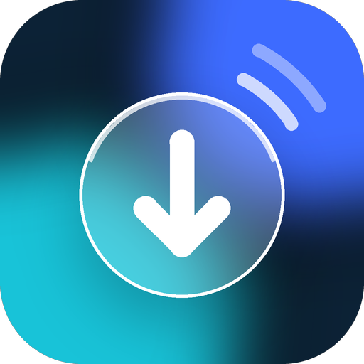
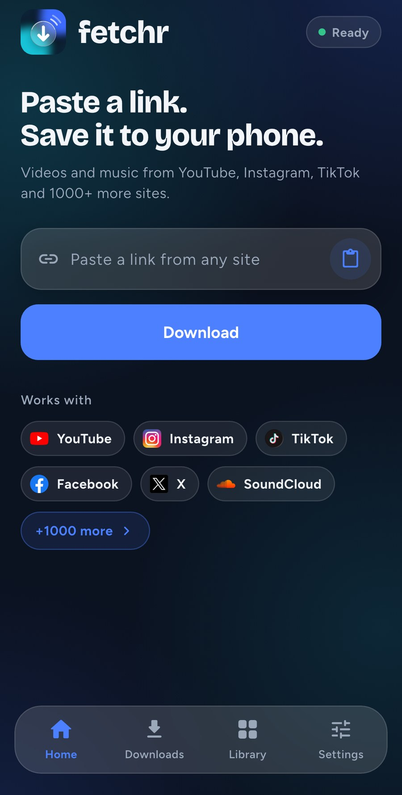
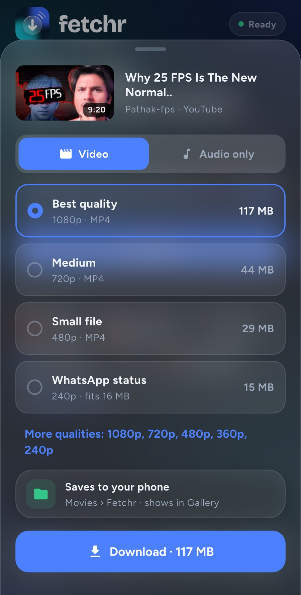
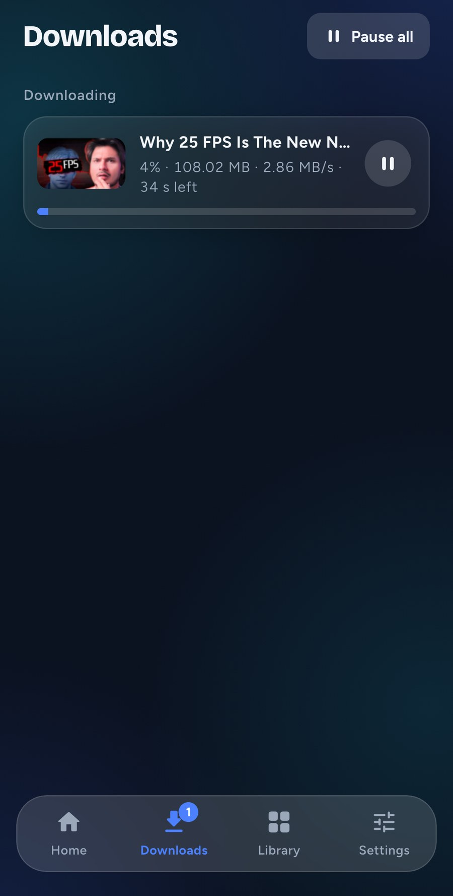
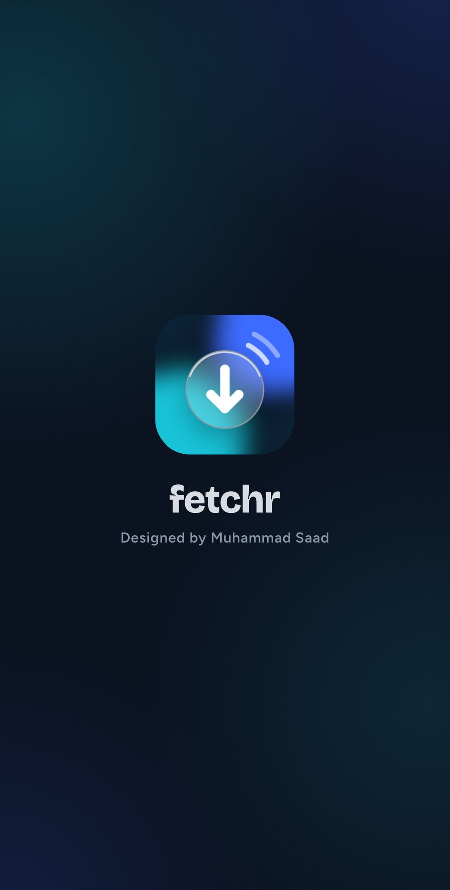
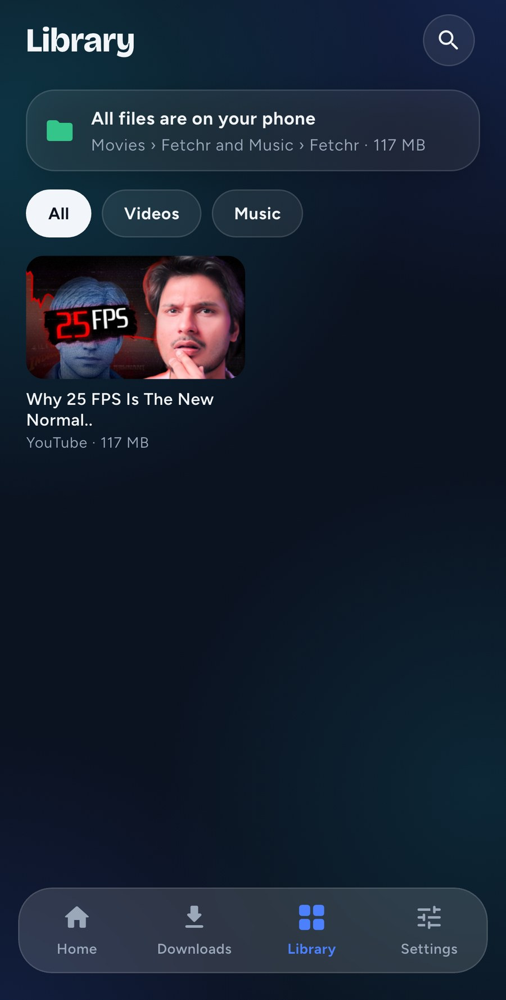
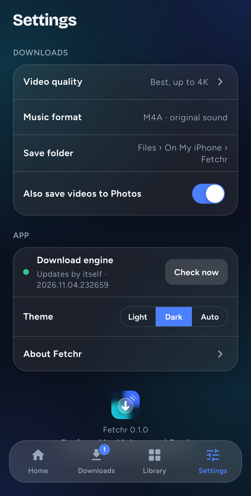
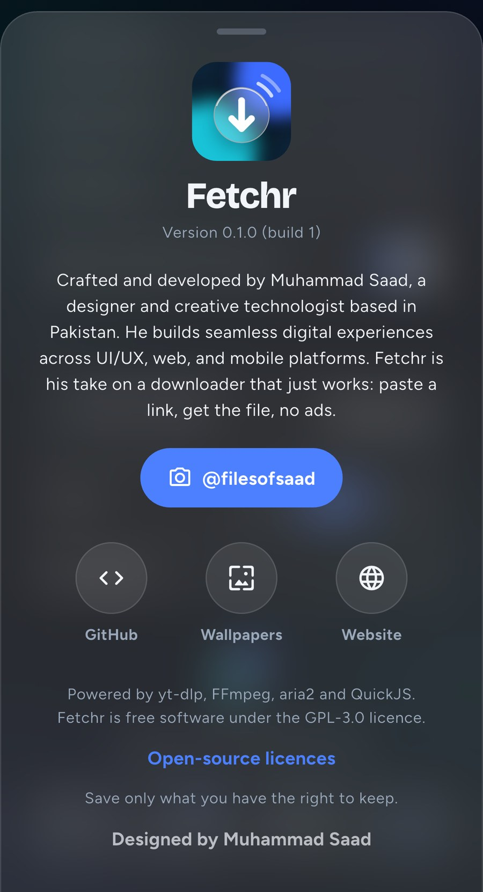

# Fetchr

**Paste a link. Save it to your phone.**
A free, ad-free video and music downloader for Android and iPhone.

[**Download**](https://github.com/craftedbysaad/fetchr-app/releases/latest) ·
[Website](https://craftedbysaad.github.io/fetchr-app/) ·
[Instagram](https://instagram.com/filesofsaad)

---

## How it works

  
  
  

1. **Paste a link,** or share it to Fetchr straight from YouTube, Instagram or TikTok.
2. **Pick the quality:** Best, Medium, Small or WhatsApp status, each with its real file size. Or Audio only.
3. **It saves to your phone.** Watch the speed and time left; pause, resume or retry any time.

## Screenshots

  
  
  
  

## Features

- 🌐 **1000+ sites:** YouTube, Instagram, TikTok, Facebook, X, SoundCloud and many more
- 🎬 **Up to 4K:** Best, Medium, Small or WhatsApp status, with real file sizes
- 🎵 **Music too:** audio only as MP3 or M4A, with the original sound
- ⚡ **Fast:** up to 3 downloads at once, with pause, resume and retry
- 📁 **Saved on your phone:** Android → Movies and Music › Fetchr (shows in Gallery). iPhone → Files › On My iPhone › Fetchr, and videos also to Photos
- 🔄 **Always up to date:** the download engine updates by itself
- 🪟 **Glass design** in Dark or Light
- 🚫 **No ads, no account, no tracking.**

## Install

**Android**
1. Download `Fetchr-<version>-arm64.apk` from the [latest release](https://github.com/craftedbysaad/fetchr-app/releases/latest). Use `-arm.apk` only on older phones.
2. Open it and allow "Install unknown apps" when asked.
3. New versions install over the old one; your files stay.

**iPhone**
1. On the iPhone, download `Fetchr-<version>-ipa.zip` from the [latest release](https://github.com/craftedbysaad/fetchr-app/releases/latest). Safari saves it to Files; tap it to unzip.
2. Share the `.ipa` to eSign, or install `Fetchr-<version>.ipa` with [Sideloadly](https://sideloadly.io) from a computer.
3. Keep Fetchr open while a download runs.

## About

Crafted and developed by **Muhammad Saad**, a designer and creative technologist.
He builds seamless digital experiences across UI/UX, web, and mobile platforms.
Fetchr is his take on a downloader that just works: paste a link, get the file, no ads.
He also made [Lyra](https://github.com/craftedbysaad/lyra-app), a free music app.

Instagram: [@filesofsaad](https://instagram.com/filesofsaad)

---

Save only what you have the right to keep. Videos and music belong to their owners.
Fetchr is powered by yt-dlp, FFmpeg, aria2 and QuickJS, and is free software under the
GPL-3.0 licence. Its full source code is attached to every release as `Fetchr-<version>-source.zip`.
